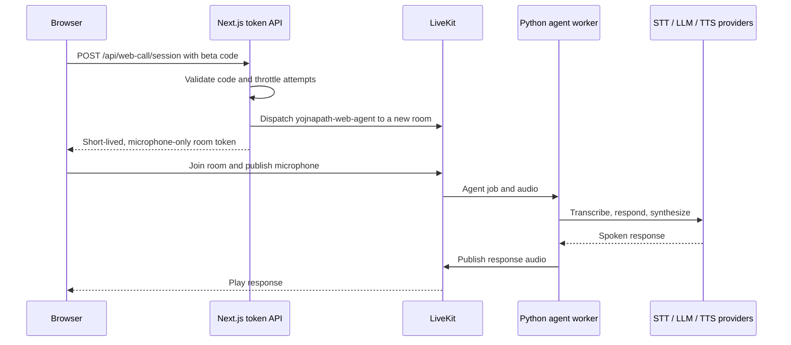

# YojnaPath architecture

YojnaPath uses the Companio live voice infrastructure with a scheme-guidance prompt and a browser-first website. The active product path is the web call; old Telegram web routes and the earlier Twilio prototype are not part of this repository's running site.

## Browser to agent flow

`src/app/web/app/api/web-call/session/route.ts` handles code validation, room creation, dispatch, and token issuance. `src/app/web/features/call/use-web-call.ts` joins LiveKit, publishes the microphone, plays the agent audio, and handles mute and hang-up. The page is `src/app/web/app/call/page.tsx` with the light call UI in `features/call/call-screen.tsx`.

`src/voice_agent/main.py` registers the Python worker under `AGENT_NAME`. `session.py`, `stt_providers.py`, and `providers.py` construct the LiveKit audio pipeline. `promptmanger.py` directs the Hindi/Hinglish scheme conversation. `call_context.py` validates dispatch metadata and enforces a maximum session duration. Optional Langfuse tracing is in `telemetry.py`.

## Conversation behavior

The agent follows a flexible call path: greet, understand whether the caller has a specific scheme or broad need, ask one clarifying question, explain general next steps, and close when the caller is done. This is **prompt guidance**, not a persisted stage graph. The worker has no scheme retrieval tool or current government data. The prompt prohibits fabricated scheme facts and asks callers to verify eligibility, deadlines, documents, and application steps with official sources.

## Trust boundaries

- The browser never receives LiveKit API secrets, provider keys, or the stored beta access code. It receives only a room-scoped participant token.
- Next.js holds the LiveKit API credentials and checks the beta code. The current rate limiter is in memory per server process and is only appropriate for a small private beta.
- The worker holds STT, LLM, TTS, and optional telemetry credentials. It connects outbound to LiveKit and providers; no browser-to-worker ingress is needed.
- The worker enforces duration from server-created dispatch metadata. Client-side timers are only a user-interface convenience.

## Deployment boundary

Deploy `src/app/web` to Vercel and the Python package as a persistent worker on GKE. Set identical LiveKit project credentials on both sides and match `LIVEKIT_AGENT_NAME` to `AGENT_NAME`. The browser connects to LiveKit Cloud directly. The current repository has no GKE deployment manifests or container image yet; [MIGRATION_VERCEL_GKE.md](MIGRATION_VERCEL_GKE.md) lists those remaining steps.

## Before public use

Add a maintained and cited scheme data source, an identity/entitlement flow, a shared rate limit, durable per-call records, a verified LiveKit completion webhook, reviewed privacy terms, and production observability. The old optional SIP/telephony module can be removed after the browser-only path is stable.
