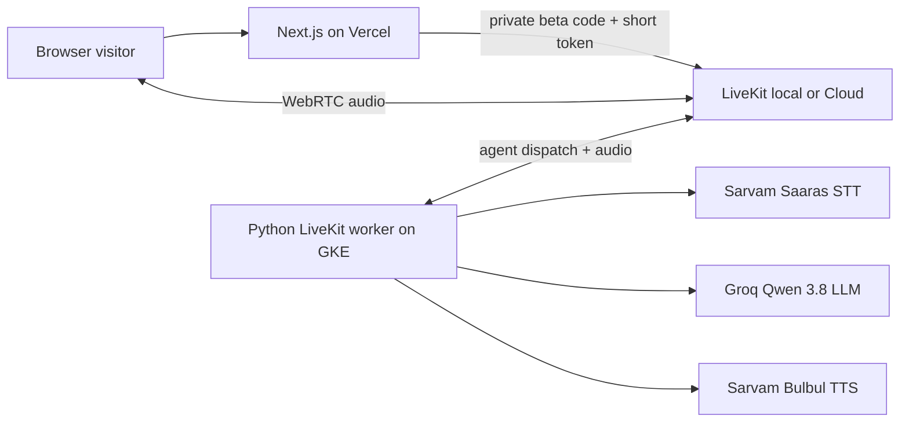

# YojnaPath

YojnaPath is a Hindi and Hinglish **browser voice guide for questions about Indian government schemes**. This repository uses the modified Companio live-audio stack as its base: a Next.js website, a short-lived LiveKit token endpoint, and a Python LiveKit voice worker. The website has a warm light theme and a `/call` page for microphone calls. A telephone number or Telegram account is not required for the web call.

**Current scope:** the agent can help a caller frame a question and understand broad next steps. It does not have a live, verified scheme database, and it must not make definitive eligibility or application-status claims. Verify current scheme details on the relevant official government source before applying.

## Architecture



The browser submits its private beta access code to `POST /api/web-call/session`. The server validates it, explicitly dispatches the named agent, and returns a microphone-only LiveKit room token. The browser sends audio directly to LiveKit. The Python worker handles speech recognition, conversation, speech synthesis, and the server-enforced call duration. See [ARCHITECTURE.md](ARCHITECTURE.md) for component details and security limits.

## Repository layout

```text
src/app/web/                 Next.js website and browser call endpoint
src/voice_agent/             Python LiveKit worker and provider configuration
tests/                       Python unit tests
.env.dev.example             Worker environment template
src/app/web/.env.local.example  Web server environment template
MIGRATION_VERCEL_GKE.md      Deployment plan
infra/                       GCP Terraform, worker Dockerfile, Helm chart
```

## Local setup

Requirements: Python 3.11 or 3.12, Node.js 22.5 or newer, `uv`, Docker Desktop, a Groq API key, and a Sarvam API key. The default voice pipeline uses Groq's free-tier LLM and Sarvam for both speech recognition and speech synthesis. Groq's free tier has rate limits; Sarvam usage has its own pricing and credits.

1. Copy the environment templates and fill in server-only credentials:

   ```bash
   cp .env.dev.example .env.dev
   cp src/app/web/.env.local.example src/app/web/.env.local
   ```

   The templates target local Docker Compose LiveKit at `ws://localhost:7880` using its development-only `devkey`/`secret` pair. Set worker `AGENT_NAME` and web `LIVEKIT_AGENT_NAME` to the same value, `yojnapath-web-agent` by default. For a local browser call, set `WEB_CALL_ACCESS_ENABLED=true` and a long private `WEB_CALL_ACCESS_CODE` in the web file. Keep both `.env.dev` and `.env.local` out of Git.

   The backend needs `GROQ_API_KEY` for the LLM and `SARVAM_API_KEY` for Saaras STT and Bulbul TTS. Leave optional provider and telemetry keys unset unless you explicitly switch to those integrations. The frontend does not receive Groq or Sarvam keys.

2. Install dependencies from the repository root:

   ```bash
   make install backend
   make install frontend
   ```

3. Start LiveKit, then the worker and website in separate terminals:

   ```bash
   make livekit-up
   make run backend
   make run frontend
   ```

   `make run backend` also starts LiveKit if it is not already running. It uses the supported `voice-agent start` mode and does not hot-reload Python code. The server is bound to localhost for same-machine development; it does not require Redis or a LiveKit Cloud account.

4. Open `http://localhost:3000/call`, enter the access code from `src/app/web/.env.local`, and allow microphone access. The browser call needs the worker to be registered with the same LiveKit server and agent name. Stop the local server with `make livekit-down` when finished.

`make install` installs both services. `make run` or `make dev` starts both local development processes together. `make build` builds both projects, and `make check` runs the test, lint, and type checks. The explicit `make install-frontend`, `make install-backend`, `make run-frontend`, and `make run-backend` targets are also available.

For a microphone and speaker test without a LiveKit server, run `uv run voice-agent console` after configuring the selected STT/LLM and TTS keys. Console mode does not exercise the website.

## Checks

```bash
uv run pytest
uv run ruff check .
uv run mypy src
npm run lint --prefix src/app/web
npm run typecheck --prefix src/app/web
npm run build --prefix src/app/web
```

## Deployment

The intended first release is **Next.js on Vercel and one persistent Python worker on GKE**. LiveKit carries the media, so the worker needs outbound connections and no public GKE ingress for browser audio. Set server-only web credentials in Vercel and provider credentials only on the worker. The private beta code and in-memory rate limiter are not sufficient for open public access or paid calls. See [infra/README.md](infra/README.md) for Terraform bootstrap, image, and Helm commands, then [MIGRATION_VERCEL_GKE.md](MIGRATION_VERCEL_GKE.md) for the rollout order and production gates.

## Known limits

- There is no verified scheme catalog, eligibility engine, official-portal integration, application submission, or document handling.
- The private beta uses one shared access code. Add identity, shared rate limiting, durable call accounting, and verified completion events before wider access.
- The old Companio-derived SIP/telephony helper remains in the Python package but is not used by the website or deployment plan.
- Set `NEXT_PUBLIC_SITE_URL` to the actual HTTPS site origin when deploying. The localhost fallback is only for development.
