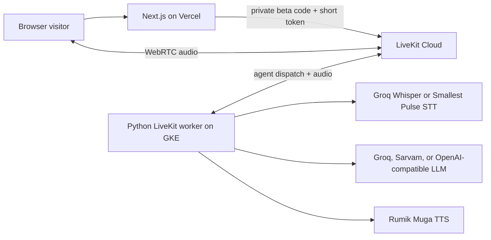

# YojnaPath

YojnaPath is a Hindi and Hinglish **browser voice guide for questions about Indian government schemes**. This repository uses the modified Companio live-audio stack as its base: a Next.js website, a short-lived LiveKit token endpoint, and a Python LiveKit voice worker. The website has a warm light theme and a `/call` page for microphone calls. A telephone number or Telegram account is not required for the web call.

**Current scope:** the agent can help a caller frame a question and understand broad next steps. It does not have a live, verified scheme database, and it must not make definitive eligibility or application-status claims. Verify current scheme details on the relevant official government source before applying.

## Architecture



The browser submits its private beta access code to `POST /api/web-call/session`. The server validates it, explicitly dispatches the named agent, and returns a microphone-only LiveKit room token. The browser sends audio directly to LiveKit. The Python worker handles speech recognition, conversation, speech synthesis, and the server-enforced call duration. See [ARCHITECTURE.md](ARCHITECTURE.md) for component details and security limits.

## Repository layout

```text
src/app/web/                 Next.js website and browser call endpoint
src/voice_agent/             Python LiveKit worker and provider configuration
tests/                       Python unit tests
.env.dev.example             Worker environment template
src/app/web/.env.local.example  Web server environment template
MIGRATION_VERCEL_GKE.md      Deployment plan
```

## Local setup

Requirements: Python 3.11 or 3.12, Node.js 22.5 or newer, `uv`, and credentials for LiveKit, Rumik, and the selected STT/LLM providers.

1. Copy the environment templates and fill in server-only credentials:

   ```bash
   cp .env.dev.example .env.dev
   cp src/app/web/.env.local.example src/app/web/.env.local
   ```

   Set the same `LIVEKIT_URL`, `LIVEKIT_API_KEY`, and `LIVEKIT_API_SECRET` in both files. Set worker `AGENT_NAME` and web `LIVEKIT_AGENT_NAME` to the same value, `yojnapath-web-agent` by default. For a local browser call, set `WEB_CALL_ACCESS_ENABLED=true` and a long private `WEB_CALL_ACCESS_CODE` in the web file.

2. Install dependencies from the repository root:

   ```bash
   make install backend
   make install frontend
   ```

3. Start the worker and website in separate terminals:

   ```bash
   make run backend
   make run frontend
   ```

4. Open `http://localhost:3000/call`, enter the access code, and allow microphone access. The browser call needs the worker to be registered with the same LiveKit project and agent name.

`make install` installs both services. `make run` or `make dev` starts both local development processes together. `make build` builds both projects, and `make check` runs the test, lint, and type checks. The explicit `make install-frontend`, `make install-backend`, `make run-frontend`, and `make run-backend` targets are also available.

For a microphone and speaker test without LiveKit Cloud, run `uv run voice-agent console` after configuring the selected STT/LLM and TTS keys. Console mode does not exercise the website.

## Checks

```bash
uv run pytest
uv run ruff check .
uv run mypy src
npm run lint --prefix src/app/web
npm run typecheck --prefix src/app/web
npm run build --prefix src/app/web
```

## Deployment

The intended first release is **Next.js on Vercel and one persistent Python worker on GKE**. LiveKit carries the media, so the worker needs outbound connections and no public GKE ingress for browser audio. Set server-only web credentials in Vercel and provider credentials only on the worker. The private beta code and in-memory rate limiter are not sufficient for open public access or paid calls. See [MIGRATION_VERCEL_GKE.md](MIGRATION_VERCEL_GKE.md) for the release order, billing caveats, and production gates.

## Known limits

- There is no verified scheme catalog, eligibility engine, official-portal integration, application submission, or document handling.
- The private beta uses one shared access code. Add identity, shared rate limiting, durable call accounting, and verified completion events before wider access.
- The old Companio-derived SIP/telephony helper remains in the Python package but is not used by the website or deployment plan.
- Set `NEXT_PUBLIC_SITE_URL` to the actual HTTPS site origin when deploying. The localhost fallback is only for development.
